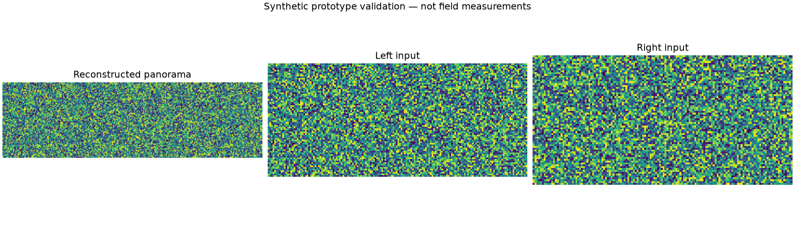
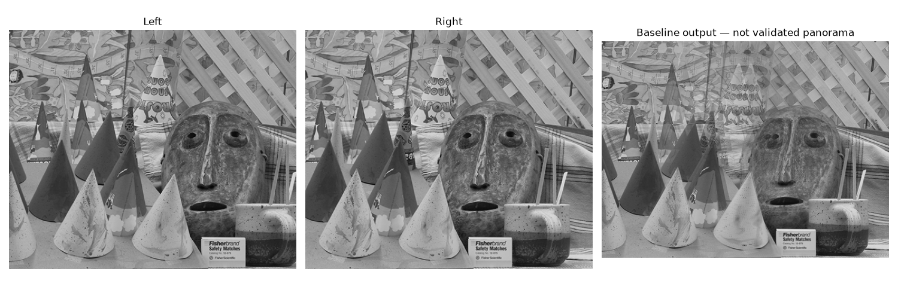
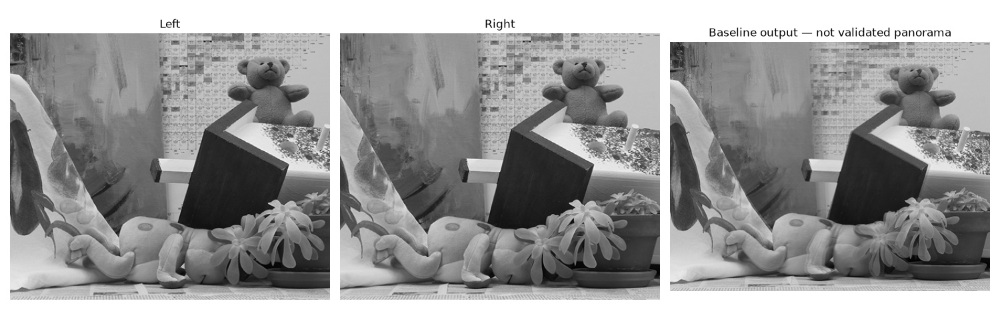

# 平移图像拼接基线

## 当前实现

归一化互相关搜索重叠区并线性融合；用于可控平移条件的基线。

这是可运行的数值基线原型，不等同于网站介绍中的完整系统。

## 输入契约

有限数值的等高灰度图像，假设相机仅水平平移且曝光一致。核心函数位于 `src/prototype.py` 的 `process`，可直接导入调用。默认命令运行固定种子合成样例，并在代码中断言预期效果；真实数据需由调用者按照函数形状约束传入。

## 快速运行

Python 3.11+。

```sh
python -m venv .venv
source .venv/bin/activate
pip install -r requirements.txt
python src/prototype.py --output artifacts
python -m unittest discover -s tests -v
```

相关性评分在归一化尺度上计算，可处理不同像素数值单位；常量图像没有可辨识纹理，会明确拒绝拼接。此数值处理不改变曝光一致与纯水平平移的输入假设。

## 输出与验证

- `artifacts/result.png`：当前代码生成的结果可视化。
- `artifacts/metrics.json`：样例指标。
- `artifacts/results.npz`：结果数组，按图例顺序编号。



```json
{
  "recovered_overlap_px": 60,
  "reconstruction_rmse": 1.4371700544036372e-17
}
```

固定种子回归检查与异常数据检查已运行。图中数据均为合成，不是硬件实测，也不是应用界面截图。

## 需求、架构与边界

[PRD](docs/PRD.md) · [当前原型范围](docs/IMPLEMENTATION.md) · [验证记录](docs/VALIDATION.md)

不处理透视、旋转、显著视差或自动货架识别。

## 后续里程碑

1. 使用真实输入建立基准数据及明确误差界限。
2. 补充数据导入和交互界面，按需求接入 SDK、设备或模型。
3. 记录独立测试集、资源消耗和失败案例，再评估部署条件。

## 公开数据复测

`python scripts/validate_public_data.py` 自动下载 Middlebury Cones/Teddy 小样本并输出报告与对比图（需要 curl）。12组真实图片受控裁切通过；原始立体图存在超出纯平移模型的视差，不能据此宣称真实货架拼接通过。详见[验证记录](docs/VALIDATION.md)。


### Cones 真实双视角效果

下图从左到右为：左输入、右输入、当前基线拼接结果。原图下载后转为灰度参与计算。



### Teddy 真实双视角效果



| 场景 | 算法选取的重叠宽度 | 对齐后重叠区灰度 RMSE |
| --- | ---: | ---: |
| Cones | 404 px | 0.14979 |
| Teddy | 419 px | 0.10793 |

灰度范围为 0—1。以上指标衡量对齐后两张输入在重叠区的差异，不是与全景真值的误差。原始双视角存在随深度变化的视差，因此图中仍有错位与融合重影；这些是公开真实图像的压力测试结果，不代表真实货架拼接验收通过。前述 12 组受控裁切测试与这里的双视角测试分别报告。

数据来源：[Middlebury 2003 Cones / Teddy](https://vision.middlebury.edu/stereo/data/scenes2003/)。按[数据使用说明](https://vision.middlebury.edu/stereo/data/)引用：D. Scharstein and R. Szeliski, *High-accuracy stereo depth maps using structured light*, CVPR 2003, pp. 195–202。原图链接、SHA256 和完整指标见[运行报告](artifacts/public-data/report.json)。
